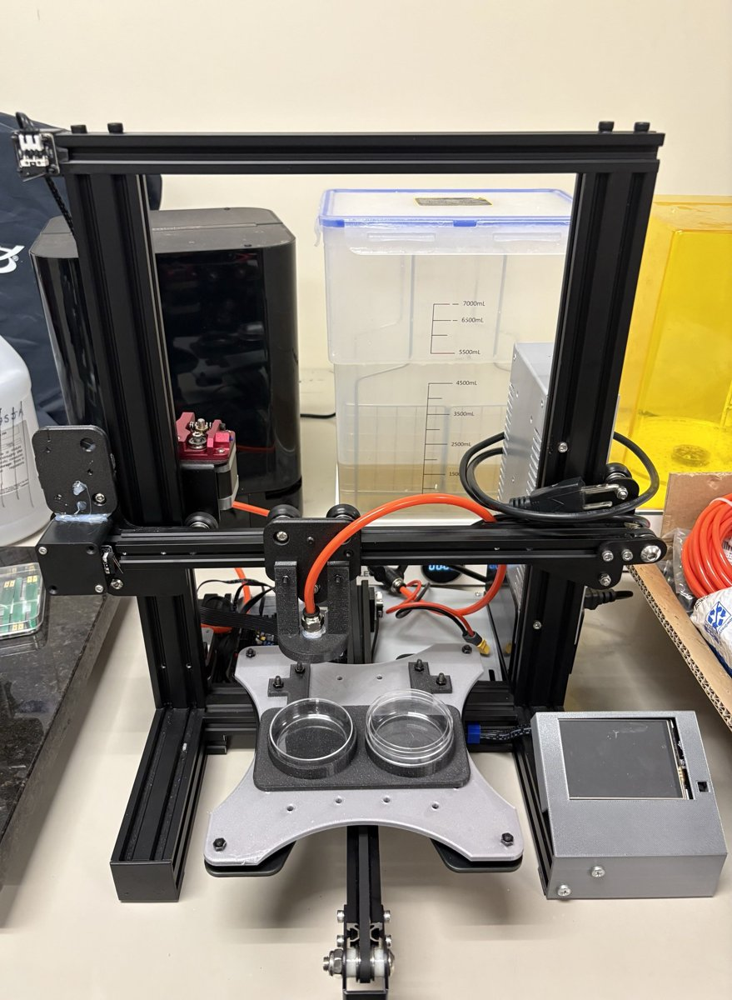
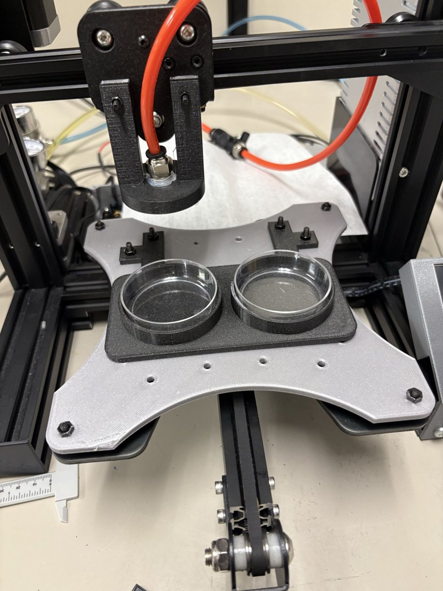
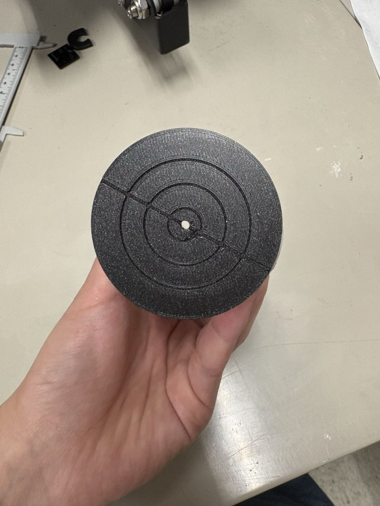
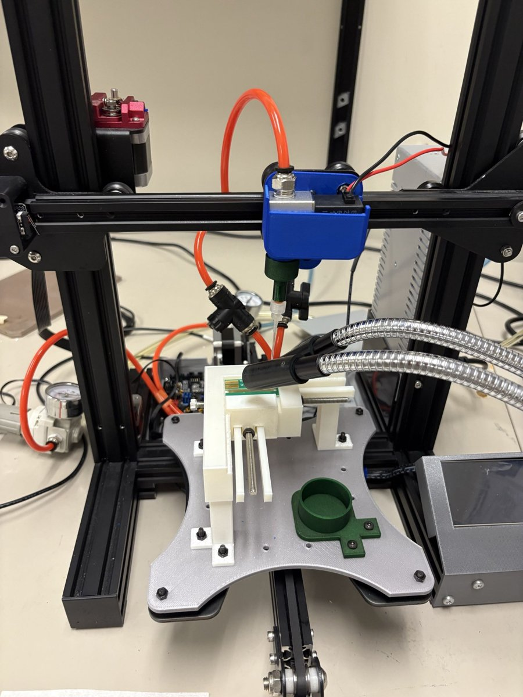

# v2 – Marlin / Solenoid Version (Summer 2026)

The rebuilt system from the Summer 2026 research term. The v1 Arduino controller was replaced with a BigTreeTech SKR V1.3 board running Marlin, and the syringe pump was replaced with a pneumatic solenoid valve. The Python GUI talks to the board in G-code.

The main finding was that capillary forces, not the dispensing method, control how SU-8 spreads across the needles. Because of that, the final process is **semi-automated**: SU-8 is applied manually, and the developer dip and IPA rinse are automated.

<p align="center">
  
  
</p>

Poster: [BURP 2026](docs/poster.pdf)

## Layout

```
gui/main_marlin.py         Tkinter GUI (jog, solenoid, teach-and-repeat, dip / dip-rinse, coating routines)
firmware/                  Changed Marlin files only — copy over a Marlin bugfix-2.1.x checkout
  platformio.ini
  Marlin/Configuration.h
  Marlin/Configuration_adv.h
  Marlin/src/gcode/gcode.cpp   adds M800
  Marlin/src/gcode/gcode.h     adds M800 declaration
stl/                       3D-printed parts (vacuum chucks, reservoirs, solenoid/tip mounts, end stop mounts, microscope holder)
data/sem/                  ImageJ tip-height measurements from SEM images (8 needles per file)
images/                    Photos of the system
docs/                      BURP poster
```

## Hardware

- Modified Ender 3 frame, BTT SKR V1.3 (LPC1768), TMC2208 drivers, NEMA 17 motors
- Steps/mm: X = Y = 40, Z = 200 (25 µm/step X/Y, 5 µm/step Z)
- 12 V normally-closed solenoid valve on the **HE0** output with a 1N4007 flyback diode
- Pneumatic parts list: [`hardware/Solenoid_Valve_Planning.pdf`](hardware/Solenoid_Valve_Planning.pdf)
- SKR V1.3 docs and pin diagram: https://github.com/bigtreetech/BIGTREETECH-SKR-V1.3

<p align="center">
  
  
</p>
<p align="center"><em>Left: vacuum chuck (concentric grooves). Right: solenoid dispensing head over the array fixture.</em></p>

## Firmware

1. Download Marlin **bugfix-2.1.x** (this build was based on the June 17, 2026 snapshot).
2. Copy everything in `firmware/` over the matching paths.
3. Build the `LPC1768` env in PlatformIO. Copy `firmware.bin` to the SD card and reset the board.

### Custom G-code: `M800`

`M800 P<ms>` fires the solenoid for exactly `<ms>` milliseconds (default 100). It waits for motion to finish, drives HE0 high, delays, and then drives it low. Timing the pulse in firmware avoids Python `sleep()` jitter below about 100 ms.

Solenoid commands the GUI uses:

| Command | Action |
|---|---|
| `M104 S50` | Solenoid open (latched) |
| `M104 S0` | Solenoid closed |
| `M800 P<ms>` | Timed pulse |

## GUI

```bash
pip install pyserial
python gui/main_marlin.py
```

The serial port is set to `COM3` at 115200 baud on line 7. Change it for your machine, e.g. `/dev/ttyACM0` on a Pi.

The X and Y axes are inverted in software with `fx()`/`fy()` because the X motor is physically reversed. Keep this in mind if you rewire the motors.
